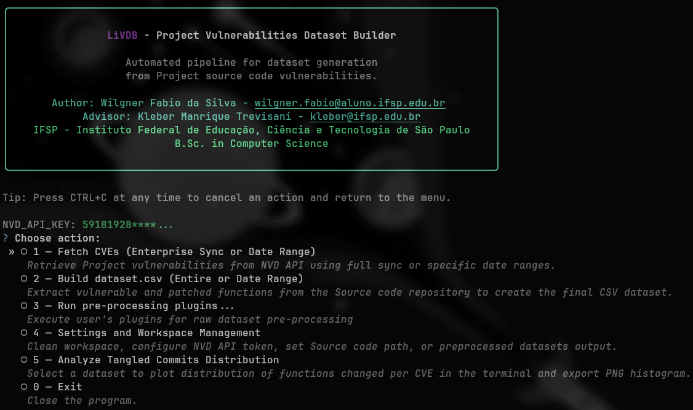

# LiVDB: Linux Vulnerability Dataset Builder

LiVDB is a comprehensive, interactive pipeline tool designed to curate, extract, and preprocess vulnerability datasets from source code histories (primarily targeted at the Linux kernel) for deep learning-based vulnerability detection models.

It streamlines the workflow from NVD API querying to training-ready Graph Neural Network (GNN) graph structures.

- **Author**: Wilgner Fabio da Silva ([`wilgner.fabio@aluno.ifsp.edu.br`](mailto:wilgner.fabio@aluno.ifsp.edu.br))
- **Advisor**: Kleber Manrique Trevisani ([`kleber@ifsp.edu.br`](mailto:kleber@ifsp.edu.br))
- **Institution**: <a href="https://pep.ifsp.edu.br/" target="_blank">IFSP - Câmpus Presidente Epitácio</a>
- **Course**: B.Sc. in Computer Science

<p align="center">
  
</p>

---

## Features

- **NVD API Syncing & Caching**: Efficiently fetches CVE metadata matching targeted CPEs (e.g., Linux kernel) using the National Vulnerability Database API and caches them locally to prevent API rate-limiting.
- **Git Commit Extraction**: Automatically analyzes CVE reference links, extracts relevant commit hashes, and checks out both the vulnerable (commit parent `hash^`) and patched (`hash`) states of modified files.
- **Interactive Dataset Curation**: Supports global deduplication (preventing training/validation leakage) and ratio-based random undersampling of clean functions relative to vulnerable ones.
- **Flexible Dataset Strategies**: Generate full-context datasets (modified + unchanged context functions) or strictly 1:1 paired datasets (vulnerable vs patched pairs only) for balanced evaluation.
- **Extensible Plugin System**: Allows developers to easily write plugins to preprocess the dataset into representations for state-of-the-art models (Devign, ReVeal, CFVD, Vul-LMGNN).
- **GNN Deep Learning Pipeline**: Contains a complete training environment (`training/`) based on the Devign and ReVeal methodologies, using PyTorch and PyTorch Geometric to train GNN/GGNN models for vulnerability classification.

---

## Directory Layout

```
.
├── plugins/                     # Feature extraction and representation plugins
│   ├── base_plugin.py           # Abstract base class for LiVDB plugins
│   ├── plugin_devign/           # Canonical Devign (6-edge CPG + Word2Vec) plugin
│   ├── plugin_reveal/           # Canonical ReVeal (12-edge CPG + Word2Vec) plugin
│   ├── plugin_cfvd/             # CFVD / ISSTA'24 (line-level PDG + GraphCodeBERT) plugin
│   ├── plugin_vul_lmgnn/        # Vul-LMGNN (CPG + CodeBERT) plugin
│   └── shared/                  # Code shared between plugins (Joern runners, exports)
├── scripts/                     # Core pipeline modules
│   ├── c_parser.py              # C AST function extractor (Tree-sitter)
│   ├── curator.py               # Dataset deduplication and balancing
│   ├── cve_fetcher.py           # NVD API syncing and git blob extractor
│   ├── dataset_builder.py       # Differential function extraction and labeling
│   ├── setup_devign_tools.py    # Automated JDK 11 & Joern 1.1.260 setup helper
│   ├── tangled_analyzer.py      # Tangled commits distribution analyzer
│   ├── ui.py                    # Rich terminal CLI interfaces
│   └── utils.py                 # Path configurations and environment loader
├── tests/                       # Automated unit and regression test suite
├── training/                    # Deep learning training pipeline (PyTorch Geometric)
├── convert_MSR_data_cleaned.py  # Big-Vul (MSR) dataset converter to LiVDB CSV schema
├── convert_devign.py            # Devign JSON dataset converter to LiVDB CSV schema
├── convert_reveal.py            # ReVeal dataset converter to LiVDB CSV schema
├── main.py                      # Main CLI entry point
└── requirements.txt             # Python library dependencies
```

*(Runtime directories such as `cache/`, `raw_data/`, `raw_code/`, `datasets/`, `preproc_datasets/`, `reports/`, `tools/`, and `models/` are created automatically during execution and ignored by Git.)*

---

## System Requirements

Running LiVDB directly on your local system requires:

1. **Python 3.10+** (tested with 3.12.5)
2. **Git** (available in your system `PATH`)
3. **Java JDK 17 or JDK 19** (required to run Joern; JDK 11 + Joern 1.1.260 can also be provisioned automatically via `scripts/setup_devign_tools.py` for canonical Devign/ReVeal pipelines)
4. **Joern CLI** (with both `joern` and `joern-parse` binaries in `PATH`)
5. **Local Clone of the Target Project** (e.g., Linux kernel repository clone)
6. **NVIDIA GPU with CUDA** *(required only for GNN model training in `training/`)*

---

## Getting Started

### 1. Installation

We strongly recommend using [pyenv](https://github.com/pyenv/pyenv) (or [pyenv-win](https://github.com/pyenv-win/pyenv-win) for Windows) to manage your Python version. This ensures compatibility with heavy Machine Learning and Data Science libraries, avoiding complex C-compilation errors during installation.

```bash
# Clone the repository
git clone https://github.com/WilgnerFSDev/LiVDB.git
cd LiVDB

# Install and select a stable Python version for ML libraries (e.g., 3.12.5) using pyenv
pyenv install 3.12.5
pyenv local 3.12.5

# Create a virtual environment
python -m venv venv

# Activate the virtual environment
# On Linux/macOS:
source venv/bin/activate
# On Windows:
venv\Scripts\activate

# Upgrade pip and install required dependencies
pip install --upgrade pip
pip install -r requirements.txt
```

> **Note (GPU Training / CUDA)**: On Windows (or if you need a specific CUDA build), install the CUDA-enabled PyTorch wheel matching your driver before or after installing `requirements.txt` (see [pytorch.org/get-started/locally](https://pytorch.org/get-started/locally/)).
>
> **Note (Virtual Environment)**: Closing your terminal will deactivate the virtual environment. Whenever you open a new terminal session to work with LiVDB, reactivate it with `source venv/bin/activate` (Linux/macOS) or `venv\Scripts\activate` (Windows).

### 2. Configuration

Create a `.env` file in the root directory based on `.env.example`:

```bash
cp .env.example .env
```

You can configure your settings directly in `.env`, or launch the CLI and let the interactive startup wizard guide you (these parameters can also be modified at any time in **Settings and Workspace Management**):

- `SOURCE_CODE_PATH`: The absolute path to your local clone of the Linux kernel (or target project repository). The startup wizard can automatically clone the official repository or prompt for an existing local path.
- `NVD_API_KEY`: *(optional)* Your NIST NVD API key to increase rate limits and speed up CVE fetching (from 5 req/30s to 50 req/30s).
- `DEFAULT_CPE`: The target Common Platform Enumeration (CPE 2.3) identifier (e.g., `cpe:2.3:o:linux:linux_kernel`) used to query and retrieve matching CVEs (`cve_id`) from the NVD API.
- `CPE_*` (`CPE_VERSION`, `CPE_UPDATE`, `CPE_EDITION`, `CPE_LANGUAGE`, `CPE_SW_EDITION`, `CPE_TARGET_SW`, `CPE_TARGET_HW`, `CPE_OTHER`): *(optional)* Granular CPE 2.3 attributes (defaults to `*`) to filter CVEs by specific versions, updates, or architectures.
- `PREPROC_DATASETS_DIR`: *(optional)* Destination directory where plugins save preprocessed datasets (default: `preproc_datasets`).
- `JOERN_BIN`: *(optional)* Explicit path to the `joern` binary (checked by `plugin_cfvd` if Joern is not in `PATH`).

### 3. Running the Tool

Launch the interactive CLI:

```bash
# On Linux/macOS:
python3 main.py

# On Windows (inside the virtual environment):
python main.py
```

Upon startup, the tool automatically checks for `git`, `joern`, and `joern-parse` in your `PATH` (Java is validated when running Joern-based plugins) and provides an interactive onboarding prompt to configure your local repository path, clone the Linux kernel, or set your NVD API Key if they are not yet configured.

---

## Plugins

LiVDB features an extensible, interactive plugin architecture where plugins located in `plugins/` are automatically recognized and displayed in the CLI menu. When executing a plugin, the user can select any generated CSV dataset from `datasets/` to process. Each plugin receives the path to the selected CSV and operates directly on it, giving researchers complete flexibility to preprocess, analyze, and transform the dataset as desired.

- **Developer Guide**: For details on how to write your own plugins, refer to the [Plugins Developer Guide](plugins/README.md).
- **Included Plugins**:
  - `plugin_devign` - Canonical Devign 6-edge CPG extraction + Word2Vec embeddings ([guide](plugins/plugin_devign/README.md)).
  - `plugin_reveal` - Canonical ReVeal 12-edge CPG extraction + 169d node features ([guide](plugins/plugin_reveal/README.md)).
  - `plugin_cfvd` - CFVD / ISSTA'24 line-level PDG extraction + GraphCodeBERT embeddings.
  - `plugin_vul_lmgnn` - Vul-LMGNN CPG extraction + CodeBERT embeddings.

---

## Pre-built Datasets

Pre-generated Linux kernel vulnerability datasets (2015-2026) and model-ready preprocessed graph representations produced by LiVDB are publicly available on Google Drive:

- **Download (Google Drive):** [LiVDB_Datasets](https://drive.google.com/drive/folders/1FSxpnW9sgxeAQ-cn5LZMa1EGNNM3aPjF?usp=sharing)

| Folder / Archive | Description |
|---|---|
| `01_csv/livdb_linux_kernel_2015-2026_raw_ast.csv.zip` | Raw extracted CSV dataset prior to deduplication and balancing. |
| `01_csv/livdb_linux_kernel_2015-2026_curated.csv.zip` | Globally deduplicated CSV dataset (393,055 functions: 19,943 vulnerable / 373,112 clean). |
| `01_csv/livdb_linux_kernel_2015-2026_balanced1to1.csv.zip` | Deduplicated and 1:1 balanced CSV dataset (`seed=42`, 39,886 functions). |
| `02_preprocessed/cfvd_cfexplainer/livdb_cfvd_pyg_data.zip` | Preprocessed PyTorch Geometric PDGs (`data.pt`) for CFExplainer / CFVD (39,524 graphs, 80/10/10 split). |
| `02_preprocessed/devign_canonical/livdb_devign_canonical.zip` | Preprocessed canonical 6-edge graphs + Word2Vec + manifests for Devign (39,835 graphs, 75/25 split, `seed=42`). |
| `02_preprocessed/reveal_canonical/livdb_reveal_canonical.zip` | Preprocessed canonical 12-edge graphs + Word2Vec + manifests for ReVeal (357,997 graphs, 80/10/10 split, `seed=42`). |
| `CHECKSUMS.sha256` | SHA-256 checksums for verifying downloaded archives (`sha256sum -c CHECKSUMS.sha256`). |

---

## Training & External Dataset Converters

- **Model Training**: See [training/README.md](training/README.md) for instructions on training and evaluating Devign and ReVeal models (`training/train_devign.py`, `training/train_reveal.py`, `training/main.py`).
- **External Benchmark Converters**: Standalone scripts in the root directory convert external vulnerability benchmarks into LiVDB's standardized CSV schema (`datasets/`):
  - `convert_devign.py` - Converts [Devign](https://sites.google.com/view/devign) JSON datasets.
  - `convert_reveal.py` - Converts [ReVeal](https://github.com/VulDetProject/ReVeal) (`.xlsx` / `.csv`) datasets.
  - `convert_MSR_data_cleaned.py` - Converts [Big-Vul (`MSR_data_cleaned.csv`)](https://github.com/ZeoVan/MSR_20_Code_vulnerability_CSV_Dataset) datasets.
- **Referenced Projects & Implementations**:
  - **Devign** (Zhou et al., NeurIPS 2019): [epicosy/devign](https://github.com/epicosy/devign) | [Dataset](https://sites.google.com/view/devign)
  - **ReVeal** (Chakraborty et al., IEEE TSE 2020): [VulDetProject/ReVeal](https://github.com/VulDetProject/ReVeal)
  - **CFExplainer / CFVD** (Chu et al., ISSTA 2024): [Zhaoyang-Chu/counterfactual-vulnerability-detection](https://github.com/Zhaoyang-Chu/counterfactual-vulnerability-detection) | [CGCL-codes/naturalcc](https://github.com/CGCL-codes/naturalcc/tree/master/examples/counterfactual-vulnerability-detection)
  - **Vul-LMGNN**: [Vul-LMGNN/vul-LMGGNN](https://github.com/Vul-LMGNN/vul-LMGGNN)
  - **Big-Vul (MSR '20)** (Fan et al., MSR 2020): [ZeoVan/MSR_20_Code_vulnerability_CSV_Dataset](https://github.com/ZeoVan/MSR_20_Code_vulnerability_CSV_Dataset)

---

## Running Tests

Run the automated test suite from the project root:

```bash
pytest
```

---

## Disclaimer

*This product uses data from the NVD API but is not endorsed or certified by the NVD.*

---

## License

LiVDB © 2026 by Wilgner Fábio da Silva is licensed under [Creative Commons Attribution-NonCommercial-ShareAlike 4.0 International (CC BY-NC-SA 4.0)](https://creativecommons.org/licenses/by-nc-sa/4.0/). See [LICENSE](LICENSE) for details.
